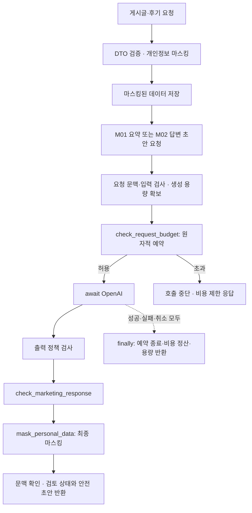

# 법률 마케팅 게시판 — 식당 리뷰 샘플을 응용하는 이유와 설계

2026-11-04 · **주말 추가 구현을 위한 설계. 현재 실행되는 기능이 아니다.** 오늘은 루트 앱의 동기 접수 등록·조회 + 비동기 AI 안내 3개 API를 유지한다. 기존 B01~B07/M01/M02를 구체화하며 API 목표 21개·action 9개를 늘리지 않는다.

## 1. 도메인 전환

| 식당 리뷰 샘플 | 법률 마케팅 게시판 | 이유 |
|---|---|---|
| 식당 게시글·소개 | 상담 준비 안내·법률사무소 서비스 소개 | 실제 사용할 주제로 복습 |
| 손님 이름 | 공개용 별칭 또는 익명 표시 | 공개 답변에 의뢰인 실명이 필요하지 않음 |
| 별점 1~5 | 상담 서비스 경험 평가 | 승소 확률이나 법률적 성과를 뜻하지 않음 |
| 음식·서비스 리뷰 | 상담 절차·응대 경험 후기 | 사건 사실·상대방 개인정보와 공개 후기를 구분 |
| 사장님 답글 | 법률사무소의 검토용 답변 초안 | 일반 안내를 만들고 사건 내용 공개를 피함 |

식당용 `ohgi-review-server`는 비교 자료로 유지한다. 후속 게시판의 공개 작성자는 별칭으로 다루며, 오늘 접수 MVP의 `clientName` 계약은 바꾸지 않는다. 원형에 없던 필드·검토 상태는 구현할 때 DTO에 명시한다.

## 2. 필수 학습 action 3개와 이유

### mask_personal_data

게시글·후기 본문에는 연락처나 사건 관련자 정보가 들어갈 수 있다. 전화번호·이메일·주민번호처럼 정의한 패턴을 `[PHONE]`, `[EMAIL]`, `[ID_NUMBER]`로 치환한다. 저장 전, AI 입력 경계, 최종 출력 경계에 적용한다. 패턴만으로 자유문 이름·주소를 완전히 찾을 수는 없으므로 합성 데이터로 실습한다.

반환 계약 제안: `safeText`, `changed`, `matchedTypes`. 발견 여부만 확인하지 않고 **변환된 본문을 다음 단계에서 사용**한다. 원문·복원 표를 로그에 남기지 않는다. 실패 시 원문을 대신 저장·전송하지 않는다.

### check_request_budget

기존 Legal Intake의 비용 기준을 Python 공유 서비스로 옮긴다. 잔액을 읽고 나중에 차감하면 동시 요청이 같은 잔액을 사용할 수 있다. `Decimal` 금액과 서버의 모델 가격·출력 상한으로 **확인과 예약을 한 원자적 구간**에서 수행한다. 사용자가 보낸 가격·금액을 신뢰하지 않는다.

반환 계약 제안: `allowed`, `reservationId`, `reasonCode`. 예산 초과는 `COST_LIMIT_BLOCKED`로 정규화하고 OpenAI 호출 0회를 보장하도록 연결한다. 호출 전 취소는 예약 해제, 시작 후 usage 미확인은 추정 정산으로 종료한다. 같은 예약을 두 번 정산하지 않는다. 가격 설정이 없는 real 호출은 거절한다. 호출 후 출력 검토·오류가 발생해도 이미 발생한 비용은 정산한다.

### check_marketing_response

M01 요약과 M02 답변 초안 모두에서 `100% 승소 보장`, `무조건 승소`, `반드시 보상받습니다` 같은 프로젝트 정책의 보장·과장 표현을 검사한다. 검토 판정을 사용자 공격 점수로 적립하지 않는다.

반환 계약 제안: `decision=REVIEW`, `reviewRequired=true`, `reasonCode=MARKETING_REVIEW_REQUIRED`, `matchedRules`, `safeDraft`. 검토가 필요한 초안은 관리용 검토 응답으로만 제공하고 공개용 흐름에는 검토가 끝난 문안을 전달하도록 설계한다. 정상 `ALLOW`도 자동 외부 게시하지 않는다. 검사기 오류는 정상 판정으로 바꾸지 않고 결과 반환을 중단한다. 이는 표현 정책 검사이며 광고 법령 적합성 자동 판정 기능이 아니다.

## 3. API와 실행 순서

기존 확장 경로를 사용한다.

- B01~B07: `/api/posts`와 하위 게시글·후기 관리. 마스킹한 데이터를 저장·조회한다.
- M01: `POST /api/posts/{postId}/ai-summary` — 저장된 게시글·후기의 요약·개선 주제.
- M02: `POST /api/reviews/{reviewId}/reply-draft` — 저장된 후기의 검토용 답변 초안.

예산 예약 뒤 `try/finally`가 생성과 모든 출력 검사·응답 준비를 감싼다. 실패·취소 시에도 정산과 용량 반환을 마친다. 위 그림은 핵심 학습 흐름이며, 기존 9개 action의 문맥·입출력 정책·세션 위험·용량·이벤트 규칙을 대체하지 않는다.

## 4. FastAPI와 NeMo 연결

Python 함수 직접 호출과 NeMo 연결은 구분한다. `nemoguardrails.actions`의 `@action()`으로 사용자 정의 함수를 등록하고 Colang 흐름이 반환값을 소비해 허용·중단·변환·검토 분기를 수행하도록 연결한다. 데코레이터만 붙이면 임의 dict가 자동으로 요청을 차단하는 것은 아니다.

필수 검사 결과를 기다린 후 다음 단계로 진행한다. Python의 `async def`/`await`와 Colang 2의 백그라운드 실행 옵션 `execute_async=True`는 다르다. 비용·마스킹·출력 검사는 결과 없이 생성·공개 단계로 넘어가면 안 된다. 짧은 패턴 검사는 로컬에서 수행하고 외부 I/O는 비동기 API를 사용한다.

근거: [NVIDIA 공식 Custom Actions 문서](https://docs.nvidia.com/nemo/guardrails/latest/configure-guardrails/actions/creating-actions). MVP의 Python 3.14와 NeMo 설치 호환성은 별도 확인 대상이다. 실제 설치 버전에 맞춰 등록·Colang 연결을 검증한다.

## 5. 주말 구현 순서와 완성 기준

1. 접수 MVP와 식당 리뷰 참고본을 비교하고 법률 게시글·후기 DTO를 확정한다.
2. 마스킹을 먼저 만들고 저장·조회·AI 입력·최종 출력에 변환 결과가 전달되는지 확인한다.
3. 예산 서비스를 넣고 동시 초과 예약 방지, 실패·취소 시 한 번만 정산을 확인한다.
4. 가짜 AI로 법률 마케팅 초안을 만들고 보장 표현·정상 표현·검사기 오류를 확인한다.
5. NeMo에 3개 action을 등록하고 실제 흐름에서 호출·반환값 소비를 확인한다. 이후 실제 OpenAI 모드에서도 같은 경계를 확인한다.

최소 사례: 연락처가 저장·AI prompt·반환에 남지 않음, 예산 초과 시 AI 호출 0회, 검사 실패 시 초안 누출 없음, 보장 표현에 검토 표시, 정상 초안에도 자동 게시 없음, 동시 요청 데이터가 섞이지 않음. 완료 후에만 README 상태를 '구현'으로 바꾼다.

관련 자료: [백엔드 설계](BACKEND_DESIGN.md) · [9개 action 상세](NEMO_ASYNC_ACTIONS.md) · [현재 접수 MVP 실행](RUN_MVP.md).
