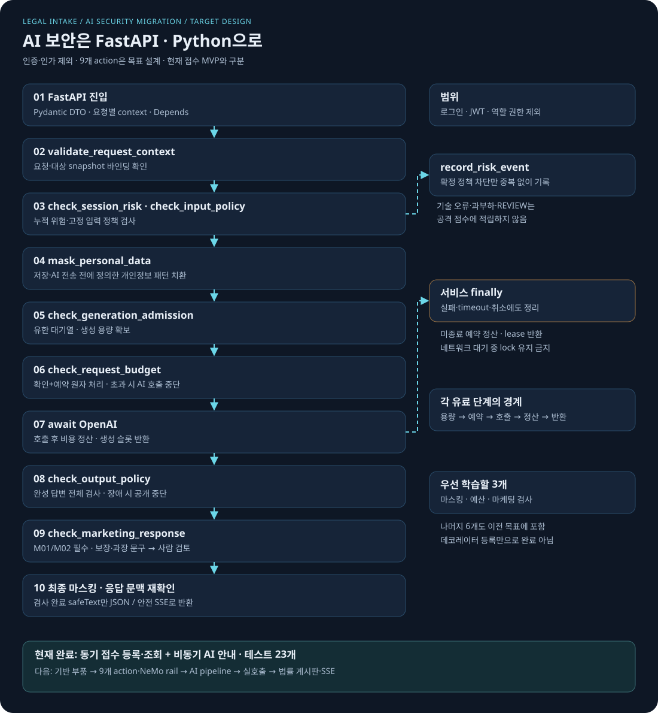

# AI 보안을 FastAPI로 옮기는 전체 설계와 다음 구현 목표

> **2026-11-09 실행 상태:** 법률 접수의 입력 정책·마스킹·출력 정책 및 용량/예산 action을 연결했다. 총 8개 action의 로컬·실제 NeMo 시험과 취소/정산 결과는 [최신 구현 기록](SECURITY_INPUT_ACTIONS_2026-11-09.md)을 따른다. 마케팅 action은 미구현이다. RAG 코드는 이 저장소 개발 범위에서 제외하며 두 기존 RAG 오류는 수정하지 않는다. 아래 11/6의 현재 상태와 RAG 문장은 당시 이력이며 최신 범위는 통합 인수인계와 현재 README를 따른다.

> **2026-11-06 부분 구현:** 개발 브랜치에서 L01 래퍼와 L02 문맥·세션 위험 3개 action을 구현했습니다.
> 아래는 원래 전체 목표 설계입니다. 현재 구현·검증 범위는 [L01/L02 구현 기록](L01_L02_IMPLEMENTATION.md)을 우선 확인하세요.

2026-11-04 · 최신 범위: **인증·인가 제외. AI 보안·개인정보·비용·비동기 자원 제어를 Python으로 이전한다.**

**이 문서는 전체 목표와 부분 구현을 구분한다.** 현재 접수 등록·조회·비동기 안내 3개 API와 L01 NeMo 래퍼, L02 문맥·세션 위험 action이 있다. 기존 시험 기록은 Python 3.12 환경에서 95 passed이며, v1 재실행 결과는 `docs/evidence/`에 별도로 남긴다. 안내 경로에는 문맥 검사와 기존 세션 차단 확인만 연결되어 있다. 입력 정책·마스킹·출력 정책·용량/예산·마케팅 검사는 아직 연결되지 않았다. OpenAI 유료 실호출도 미검증이다. RAG 이번 범위는 [확정 v1](RAG_V1_PLAN.md)의 합성 학습뿐이며 운영 접수와 연결하지 않는다.

## 1. 확정한 범위

| 포함 | 담당 위치 | 제외 |
|---|---|---|
| 입력 공격·법률 악용·secret 요청 검사 | Python action과 NeMo 입력 rail | 로그인·회원가입 |
| 개인정보 패턴 마스킹·출력 검사 | Python action과 NeMo 출력 rail | JWT 발급·검증 |
| 세션 누적 위험·중복 없는 위험 이벤트 | action + 메모리 위험 저장소 | 역할별 권한·자원 소유권 검사 |
| 예산 예약·정산·비용 차단 | action + 비용 서비스 | Spring Security 이전 |
| 동시 생성 제한·유한 대기·취소 정리 | action + 비동기 자원 관리자 | 공개 운영 배포 |
| 법률 마케팅 표현 검사·검토 표시 | M01/M02 공통 출력 pipeline | 자동 외부 게시 |

실험 경로는 **브라우저/Swagger → Uvicorn → FastAPI → Python/NeMo → OpenAI**다. Spring Boot를 거치지 않는다. 세션 식별자·문맥 검사는 신원이나 권한을 증명하지 않는다. 기존 로드맵 ① → ③ → ②는 유지하며 hybrid 인증 연동은 이번 구현 목표에서 뺀다.

## 2. 전체 흐름도 읽기



[Dark Tablet 설명 화면](security-migration.html) · [Mermaid 편집 원본](assets/security-migration.mmd)

1. 요청별 context를 만들고 Pydantic으로 형식·길이를 확인한다.
2. 현재 세션 위험과 입력 정책을 확인하고, 저장·외부 전송 전 개인정보를 가린다.
3. 실제 유료 단계가 실행될 때만 용량을 확보한 다음 비용을 예약한다.
4. `await`로 AI를 호출한다. 기다리는 동안 이벤트 루프는 다른 요청을 처리할 수 있다.
5. 생성 전체를 검사하고 마케팅 초안이면 표현 검사도 수행한다. 최종 마스킹한 동일 본문만 반환한다.
6. 실패·취소·검토 판정과 관계없이 발생한 비용을 정산하고 실행 슬롯을 반환한다.

그림의 보안 단계는 **목표 설계**다. 현재 MVP 요청이 이미 이 9개 검사를 통과하는 것은 아니다.

## 3. Spring에서 Python으로 가져올 것

| 기존 개념 | FastAPI 이전 책임 | 그대로 두거나 달라지는 점 |
|---|---|---|
| 고정 입력 방어 규칙 | `check_input_policy` | 기존 사유 코드·공격/정상 사례를 회귀 테스트로 보존 |
| 동적 세션 방어 | `check_session_risk`, `record_risk_event` | TTL·저장 용량과 중복 방지 추가; 로그인 기능은 아님 |
| 비용 제어 서비스 | `check_request_budget` + `BudgetStore` | Java 코드를 호출하지 않고 규칙·예약 상태를 Python으로 구현 |
| 외부 NeMo HTTP 어댑터 | FastAPI 프로세스 내부 NeMo adapter | 직접 Python 함수를 부르는 시험과 실제 rail 시험을 구분 |
| 출력 방어 | `check_output_policy`, `mask_personal_data` | 전체 검사 완료 본문만 JSON/SSE로 반환 |
| Java 응답 reasonCode | Python enum/응답 DTO | 함수명과 판정 사유를 구분; 신규 코드도 구분 |
| 스레드·종료 콜백 | async 자원 관리자·`finally` | 네트워크 대기 중 lock을 잡지 않고 취소 때 정리 |
| 기존에 없던 보강 | 문맥 연결·용량 제어·마케팅 검사 | 기존 Java 기능과 동일하다고 표시하지 않음 |

원본 대조 기준은 로컬 `legal-ai-intake-security-server`의 API 명세와 Java 보안·비용 서비스다. Python으로 옮길 때는 Java 메서드 개수보다 **같은 입력에서 같은 판정과 사유가 나오는지**를 비교한다. 모든 Java 보안 구현을 복사·이전 완료했다는 의미는 아니다.

## 4. Python action 9개의 구현 계약

| action | 입력·실행 시점 | 결과·실패 처리 | 필요한 검증 |
|---|---|---|---|
| `validate_request_context` | 서버 생성 traceId·요청·대상 snapshot, 진입/반환 직전 | 불일치 `REQUEST_CONTEXT_MISMATCH`, 기술 오류로 중단 | 동시 A/B 응답·검사 결과 혼합 방지 |
| `check_session_risk` | 정규화 세션 ID, 입력 검사 전 | 기존 차단이면 `DYNAMIC_SESSION_BLOCKED` | 차단 전후·TTL·저장 용량·세션 누락 |
| `check_input_policy` | Chat/후기 본문과 서버 정책 profile | 기존 BLOCK 사유와 안전 응답 | 정상·jailbreak·injection·privacy·secret 사례 |
| `mask_personal_data` | 저장·전송·최종 출력 경계의 본문 | `TRANSFORM`과 `safeText` | 전화·이메일·주민번호 패턴, 변환 본문 전달 |
| `check_generation_admission` | 각 유료 호출 직전의 서버 용량 정책 | lease 또는 `GENERATION_CAPACITY_EXCEEDED` | 동시 2·대기 4·0.5초 예시, 취소 시 누수 0 |
| `check_request_budget` | 모델·단계·출력 상한, 용량 확보 후 | 원자적 예약 또는 `COST_LIMIT_BLOCKED` | 동시 초과 예약 방지·중복 정산 방지 |
| `check_output_policy` | 완성한 생성 본문 | ALLOW/BLOCK, 검사 오류 시 반환 중단 | 빈값·길이·민감정보·정책 위반 |
| `check_marketing_response` | M01/M02 전체 결과 | `REVIEW`·검토 상태·안전 초안 | 보장·과장·인용/부정문·정상·검사기 실패 |
| `record_risk_event` | 확정 정책 차단의 traceId+단계 | 중복 없는 점수·요약 이벤트 | 동일 위험 1회, 기술 오류·과부하·검토 판정 제외 |

첫 학습 묶음은 **마스킹·비용·마케팅 3개**, 나머지 6개도 이전 목표에 포함한다. 입력/출력/문맥 검사 등 필수 경계를 갖추기 전에는 세 함수만으로 보안 이전 완료라 표시하지 않는다.

## 5. action으로 만들지 않는 책임

action은 정책을 판단하는 함수다. 슬롯 점유·예산 장부·종료 처리를 전부 action에 넣으면 뒤 단계가 실패했을 때 자원이 남을 수 있다.

| 부품 | 책임 | 이유 |
|---|---|---|
| FastAPI DTO·예외 처리기 | 형식·길이·422·오류 메시지 정규화 | 입력값이 오류 응답으로 노출되는 경계까지 관리 |
| 요청별 context/envelope | 본문·snapshot·검사 버전 묶기 | 공유 client에 현재 질문을 저장하지 않음 |
| `AdmissionManager` | 유한 대기열·실행 lease 획득/반환 | semaphore 하나만으로 대기열 크기는 제한되지 않음 |
| `BudgetStore` | 원자 예약·단발 정산·장부 | 정책 ALLOW와 실제 예약 상태를 일치시킴 |
| AI pipeline service | action 순서·공급자 호출·반환 본문 확정 | 사용자가 action 이름·정책·검사 생략을 지정하지 못함 |
| `finally`/async context manager | timeout·취소·정산·슬롯 반환 | 다음 action 실행 여부와 무관하게 정리 |
| lifespan | 공유 client·NeMo·저장소 생성과 종료 | 요청 데이터와 공유 연결의 수명을 구분 |

일반 `def` helper를 async 함수 안에서 호출한다고 자동으로 스레드 풀로 이동하지 않는다. 기존 동기 Repository의 잠금 대기는 `to_thread`로 분리하고, 외부 HTTP/DB는 비동기 client를 선택한다. CPU 작업이 커지면 별도 실행 자원을 검토한다.

## 6. 정상·차단·오류·취소 흐름

| 상황 | 반환/처리 원칙 | 위험 점수 |
|---|---|---|
| 정상 | 검사 완료 `safeText`와 적용한 정책 정보를 응답 계약에 맞춰 반환 | 없음 |
| 입력/출력 정책 차단 | 기존 BLOCK 사유 + 안전 응답, 원문 출력 금지 | 해당 정책만 중복 없이 기록 |
| 예산 초과 | 생성하지 않고 비용 제한 사유 반환 | 공격 점수로 적립하지 않음 |
| 마케팅 검토 | 검토 상태와 마스킹한 초안, 자동 게시 없음 | 적립하지 않음 |
| 문맥 불일치 | 500 기술 오류, 다른 요청 본문 반환 금지 | 적립하지 않음 |
| 용량 초과 | 503 기술/자원 오류 | 적립하지 않음 |
| OpenAI 실패 | 기존 502 계약 유지, 원문 예외·키 노출 금지 | 적립하지 않음 |
| 필수 rail 장애 | 안전하게 중단, 허용으로 우회하지 않음 | 장애를 공격으로 기록하지 않음 |
| 사용자 취소·timeout | 호출 취소 요청 후 bounded cleanup; 이미 발생한 사용량 처리 | 적립하지 않음 |

기존 차단 응답과 추가 endpoint의 HTTP/JSON 계약은 각각 고정한다. 모든 정책 차단을 무조건 500으로 바꾸거나, 모든 기술 오류를 정책 BLOCK으로 합치지 않는다.

## 7. 비용과 비동기의 핵심

각 유료 단계는 **용량 확보 → 비용 예약 → 호출 → 정산 → 슬롯 반환** 순서다. 유료 입력·출력 검사를 켜면 각각 별도 단계를 사용한다. 로컬 규칙 검사는 비용 예약이 필요 없다.

예약 상태는 `OPEN → REPORTED | ESTIMATED | RELEASED` 중 한 번만 전이한다. 호출 전 중단은 해제, 공급자가 사용량을 보고하면 설정 단가로 계산, 호출 시작 뒤 사용량을 모르면 추정 정산한다. 사용량 미확인을 0원으로 쓰지 않는다. 실제 제공자 청구액을 완벽히 보장하는 장부라고 설명하지 않는다.

슬롯은 네트워크 호출 구간에만 점유한다. 출력 검사가 유료면 새 lease를 얻는다. 슬롯을 잡은 채 같은 한도의 하위 유료 검사를 다시 기다리는 교착 구조를 피한다. 정산·반환 작업은 취소 중에도 끝나도록 제한 시간이 있는 cleanup을 사용한다.

단일 worker 메모리 장부부터 검증한다. 여러 worker·재시작 이후 전역 한도는 이후 Redis/DB 등 공유 저장소와 원자 연산으로 확장할 목표다.

## 8. 법률 마케팅 게시판과 챗봇 재사용

- Chat/SSE, M01 게시글·후기 요약, M02 답변 초안이 공통 보안 pipeline을 사용한다.
- 입력 profile은 Chat과 후기 분석을 구분한다. 후기 속 문장을 시스템 지시로 승격하지 않는다.
- 마케팅 검사는 M01/M02에서 필수이며 정상 판정이어도 자동 게시하지 않는다.
- SSE는 **전체 생성 → 전체 출력 검사 → 최종 마스킹 → 안전 청크 전송**이다. 비동기라고 미검사 토큰부터 보내지 않는다.
- 식당 리뷰 원형은 비교 자료로 보존한다. 법률 도메인 변경 내용은 [게시판 해설](LEGAL_MARKETING_BOARD.md)을 따른다.

## 9. 다음 구현 순서와 종료 기준

| 단계 | 구현 목표 | 끝났다고 판단할 증거 |
|---|---|---|
| 0 · 현재 | 접수 MVP 3개, L01 래퍼, L02 문맥·세션 위험 | 기존 전체 시험 95개 기록; 새 v1 추가 시험은 별도 집계. 유료 실호출 미검증 |
| 1 · 주말 첫 작업 | action 결정 DTO·요청 context·마스킹·공유 위험/비용/용량 저장소 | 합성 데이터 단위 시험, 경쟁·중복·취소 시험 |
| 2 | 우선 3개와 나머지 6개 action 구현, NeMo 등록·입출력 rail 연결 | 9개 실제 호출과 결과 소비·차단/변환 통합 시험 |
| 3 | 현재 안내/주력 Chat에 공통 보안 pipeline 연결 | fake 외부 호출 0, 차단·장애 시 AI 호출 0 또는 안전 중단, A/B 격리 |
| 4 | 실제 OpenAI 단건 검증 | 계정 접근 가능한 모델·키로 응답·오류·정산 확인; 실비와 가짜 검증 구분 |
| 5 | 비동기 법률 게시판·M01/M02·검사 후 SSE | 검토 플래그·안전 본문 일치, 미검사 본문 누출 0, 단절 정리 |
| 6 · 이후 확장 | Redis/DB 공유 장부·영속 이벤트·여러 worker 검증 | 재시작·프로세스 간 동시성·실패 복구 시험 |

이전 21개 API는 계획 목록으로 유지한다. 현재 MVP 3개와 과제 참고본 3개를 여기에 합산하지 않는다. 인증 API를 추가하거나 이번 21개 목록에 슬쩍 포함하지 않는다. 주말에 모든 단계를 끝낸다고 약속하는 일정도 아니다. 한 단계씩 검증한다.

## 10. 목표 파일 배치

```text
app/                         # 아래 security 관련 항목은 생성할 목표
  security/
    decisions.py             # ALLOW/BLOCK/TRANSFORM/REVIEW, 사유 enum
    context.py               # 요청별 불변 context·snapshot envelope
    actions.py               # 프로젝트 사용자 정의 action 9개
    nemo_adapter.py          # @action 등록·rail 호출·결정 검증
    budget_store.py          # Decimal·예약·단발 정산
    risk_store.py            # TTL·용량·중복 없는 위험 이벤트
    admission.py             # 유한 대기·실행 lease
  services/
    ai_pipeline.py           # 공통 검사·호출·검사·정리
  core/
    exceptions.py            # 정책 결과와 기술 오류 분리 확장
  main.py                    # lifespan 조립 확장
tests/
  test_security_actions.py   # 생성할 목표
  test_security_pipeline.py
  test_nemo_integration.py
```

위 파일 배치는 계획이며 파일이 이미 존재한다는 뜻이 아니다. 현재 `app/clients/llm_client.py`와 접수 계층은 재사용한다. 원본 Spring을 수정할 필요 없이 FastAPI 안에서 실험한다.

## 11. 환경·NeMo 연결의 완료 조건

NeMo는 `@action()` 등록만으로 임의 dict 반환값을 자동 차단으로 해석하지 않는다. Colang 흐름 또는 설치 버전에 맞는 명시적 rail 결정 API가 결과를 소비해야 한다. Python 함수 시험, NeMo 등록 시험, 실제 rail 통합 시험을 따로 수행한다. 필수 검사는 완료를 기다리고 다음 단계로 진행한다. Python `await`와 Colang 2의 백그라운드 실행 옵션은 구분한다.

루트 MVP 선언은 Python 3.14이며 L01/L02는 별도 `security-runtime`의 Python 3.12.10, NeMo 0.24.1 고정 lock으로 검증한 기록이 있다. 3.14에서 NeMo가 된다고 가정하지 않는다. RAG 의존성도 기존 환경을 덮어쓰지 않는 3.12 환경으로 분리하며 선택 이유와 lock 해시는 S0 증거에 남긴다.

v1 L02 계약: 위험 점수는 확인된 사용자 **입력** 정책 차단만 적립한다. 출력·검색 자료 위반은 본문 없는 감사 metadata만 기록한다. `OUTPUT_POLICY_BLOCKED`는 적립 사유가 아니다. 검색 자료 검사 계약은 사용자 입력 검사와 분리하며 실제 연결은 B03 이후다.

## 12. 비전공자용 한 번 더 설명

**action은 검사원**, **서비스는 검사 순서를 정하는 진행자**, **저장소는 장부**, **finally는 퇴실 정리**라고 생각하면 된다. 검사원이 “예산 OK”라고 말하는 것과 장부에 실제 예약을 남기는 것은 연결되어야 한다. 진행이 중단되어도 장부와 자리는 정리해야 한다.

“비동기”는 검사 생략이 아니다. AI 응답을 기다리는 동안 다른 요청을 처리하는 방식이다. 각 요청의 질문과 결과는 별도로 보관하고, 검사 결과가 나온 뒤에만 다음 단계로 진행한다. “인증 없음”도 “아무 보안 없음”이라는 뜻은 아니다. 이번에는 **누가 접속했는가**를 다루지 않고 **무슨 내용을 보내고 무엇을 반환하며 비용·자원을 어떻게 제한하는가**를 실험한다.

## 13. 근거와 함께 읽을 자료

- [NVIDIA: 사용자 정의 action 생성](https://docs.nvidia.com/nemo/guardrails/latest/configure-guardrails/actions/creating-actions) · [action 등록](https://docs.nvidia.com/nemo/guardrails/latest/configure-guardrails/actions/registering-actions)
- [NeMo 배포·Python 요구사항](https://pypi.org/project/nemoguardrails/0.24.1/)
- [FastAPI: 동기·비동기와 일반 helper 실행](https://fastapi.tiangolo.com/async/)
- [9개 action 상세 설계](NEMO_ASYNC_ACTIONS.md) · [전체 API 설계](BACKEND_DESIGN.md) · [현재 MVP 실행](RUN_MVP.md)
