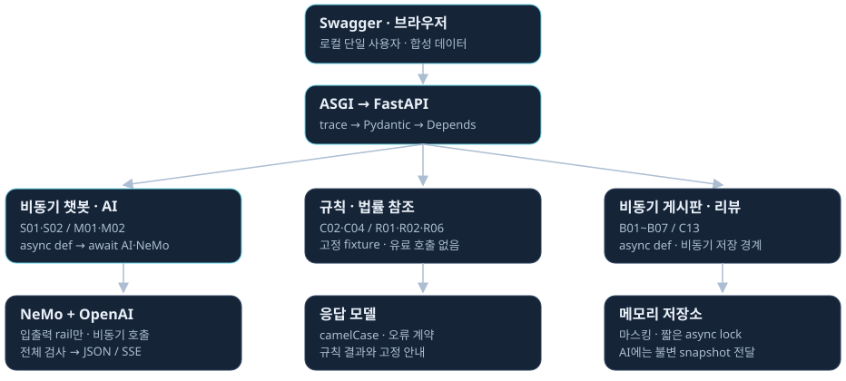

# 처음부터 이해하는 Legal Intake 비동기 FastAPI

비전공자를 위한 공부용 설명자료 · 2026-11-04

최신 확장은 **인증·인가를 제외한 AI 보안 전체의 FastAPI 이전**입니다. [9개 action 전체 흐름과 다음 구현 목표](security-migration.html) · [설계 원문](SECURITY_MIGRATION_PLAN.md)을 함께 보세요. 기존 접수 MVP와 아직 구현하지 않은 보안 확장을 구분합니다.

이 자료의 목표는 코드를 외우는 것이 아니라, **질문 하나가 어디로 들어가서 어떤 검사를 거쳐 답변으로 돌아오는지 설명할 수 있게 되는 것**입니다. 이미 Spring Boot에서 보았던 Controller, Service, DTO를 출발점으로 사용합니다. 낯선 용어는 역할을 먼저 이해하고 이름을 익히면 됩니다.

현재 루트에는 **Legal Intake MVP: 동기 접수 등록·조회 + 비동기 AI 안내**를 구현하고 테스트 23개·실제 fake HTTP를 확인했습니다. [MVP 실행 안내](RUN_MVP.md)를 먼저 보면 됩니다. NeMo·확장 21개 API는 아직 설계입니다. 별도 리뷰 참고본은 테스트 11개를 확인했고 실제 유료 OpenAI 연결은 미검증입니다.

강사가 AI로 코드를 통째로 생성해 제출하지 말라고 안내했으므로 이 앱은 개인 복습용 AI 생성 참고본으로 표시했습니다. 직접 작성할 때 엔티티→저장소→DTO→예외→서비스→DI→라우터→main 순서로 따라가며 비교합니다. 실제 Uvicorn에서 동기 worker와 비동기 MainThread도 확인했지만, Postman 직접 실험과 유료 연결을 완료한 것으로 표시하지 않습니다.

먼저 [백엔드 흐름도](backend-dark-tablet.html) 1번 화면을 열어두고 읽으면 구조를 따라가기 쉽습니다. 계약의 정확한 목록은 [상세 설계서](BACKEND_DESIGN.md), 학습 방향은 [README](../README.md)를 기준으로 봅니다.

## 1. 우리가 만들려는 것은 무엇인가요?

사용자가 법률 절차를 질문하거나 게시판 후기의 요약을 요청하면, 서버가 내용을 확인한 뒤 AI에 전달하고 안전하게 정리한 답변을 돌려주는 실험입니다.

```text
사용자: “상담 전에 준비할 자료를 알려주세요.”
    ↓
FastAPI: 요청 형식과 내용 확인
    ↓
Python 보안 검사: 위험한 요청인가? 개인정보는 가렸는가?
    ↓
비용 확인: 이번 AI 호출 비용을 감당할 수 있는가?
    ↓
OpenAI: 답변 생성
    ↓
Python 출력 검사: 답변을 그대로 보여줘도 되는가?
    ↓
사용자: 검사와 마스킹을 마친 답변 확인
```

모든 기능이 AI를 부르는 것은 아닙니다. 미리 준비한 절차 목록을 보여주거나 정해진 규칙으로 사건 종류를 분류하는 기능은 AI 없이 처리할 수 있습니다. 게시글 저장도 그 자체로는 AI 작업이 아닙니다.

**수업 과제의 실제 요구는 동기 리뷰 등록·조회 + 비동기 답글입니다.** 별도 ohgi-review-server 앱에 요구대로 구현했습니다. 리뷰를 동기로 저장·조회하고, 답글 서비스는 저장된 리뷰로 프롬프트를 만들어 LLM을 await합니다. 주력 Legal Intake 확장은 별도 설계이며 비동기 챗봇·마케팅 검사를 포함합니다.

별도 def 비교 예제는 FastAPI의 worker thread에서 실행됩니다. 이벤트 루프를 일부러 막는 예제는 아닙니다. 동기는 일반 CRUD에도 유효하지만 이번에는 최소 비교만 하고, 주력 앱에서는 AI 대기 중 비동기 게시판이 응답하는지 확인합니다.

## 2. 화면·서버·API를 구분해 봅시다

음식점에 비유하면 화면은 주문하는 자리, API는 주문서 양식과 접수 창구, 백엔드는 주문을 확인하고 실제 작업을 하는 내부입니다. 비유는 역할을 이해하기 위한 것이며 실제 스레드 수와 일대일로 대응하지는 않습니다.

| 용어 | 쉬운 뜻 | 이번 프로젝트의 예 |
|---|---|---|
| 프런트엔드 | 사람이 보고 누르는 화면 | 챗봇 입력창, 변호사 게시판 |
| 백엔드 | 요청을 받아 처리하는 서버 내부 | 검사·비용 판단·AI 호출 |
| API | 프로그램끼리 주고받는 정해진 요청·응답 약속 | POST `/api/ai/chat` |
| 요청 | 사용자가 서버에 보내는 내용 | 질문 문장 |
| 응답 | 서버가 사용자에게 돌려주는 결과 | 답변, 차단 여부, 사유 코드 |
| JSON | 이름과 값을 짝지어 전달하는 데이터 형식 | `{"message":"상담 준비자료는?"}` |
| 엔드포인트 | API의 HTTP 방식과 주소 조합 | GET `/health` |
| Swagger | API를 직접 시험할 수 있는 문서 화면 | `/docs`의 Try it out |

`POST`는 처리할 내용을 보내는 요청에, `GET`은 조회에 주로 씁니다. `PATCH`는 일부 수정, `DELETE`는 삭제입니다. API 개수는 함수 이름만이 아니라 **HTTP 방식과 경로의 조합**으로 셉니다.

API가 있다는 것과 화면이 있다는 것은 다릅니다. 첫 단계에서는 완성된 웹 화면 없이 Swagger만으로도 공부할 수 있습니다.

## 3. 전체 구조를 여덟 역할로 읽기



| 순서 | 부품 | 쉬운 역할 | 이전 Spring에서 떠올릴 것 |
|---|---|---|---|
| 1 | Uvicorn / ASGI | 인터넷 요청을 받아 FastAPI에 전달하는 실행 기반 | 내장 서버와 서버 인터페이스 |
| 2 | Middleware | 요청 전후 공통 작업: 추적 번호·시간·로그 | Filter·Interceptor의 공통 처리 역할 |
| 3 | Pydantic | 필수 항목과 값의 형식 검사 | DTO + Bean Validation |
| 4 | APIRouter | 주소에 맞는 요청 처리 함수 연결 | Controller |
| 5 | Depends | 필요한 부품을 준비해 전달 | 의존성 주입 |
| 6 | Service | 업무 처리 순서를 조립 | Service |
| 7 | Client / action | 외부 AI 호출 또는 정책 검사 | 외부 호출 클래스·정책 서비스 |
| 8 | 응답 모델 / SSE | 결과를 약속된 형식으로 돌려줌 | 응답 DTO·SseEmitter |

이 표의 순서는 역할을 이해하기 위한 순서입니다. Pydantic 모델 검증과 Depends는 FastAPI가 요청을 해석하면서 처리하며, 모델·의존성 트리 구조에 따라 세부 실행 순서가 정해집니다. 항상 모든 검증이 끝난 뒤에야 어떤 dependency도 실행된다고 가정하면 안 됩니다. 유료 호출은 dependency 생성이 아닌 검증된 서비스 흐름에 둡니다.

**Router는 접수, Service는 처리 순서, Client는 외부 연락, action은 특정 검사**라고 나누어 읽으면 됩니다.

## 4. Spring Boot와 FastAPI는 무엇이 다른가요?

둘 다 API 서버를 만들 수 있습니다. Spring도 비동기를 지원하고 FastAPI도 잘못 작성하면 요청을 막을 수 있습니다. 이번에는 기술의 우열보다 Python에서 부품을 연결하고 기다리는 방법을 배우는 것이 목적입니다.

| Spring Boot에서 익힌 것 | FastAPI에서 보는 것 | 공부할 때 연결할 뜻 |
|---|---|---|
| `@RestController` | `APIRouter` | 주소와 처리 함수를 묶음 |
| `@PostMapping` | `@router.post(...)` | 어떤 POST 요청을 받을지 지정 |
| Java record DTO | Pydantic `BaseModel` | 주고받을 데이터의 구조 |
| `@NotBlank`, `@Size` | `Field`, validator | 값의 조건 검사 |
| 생성자 주입·Spring Bean | 생성자 주입 + `Depends` | 필요한 부품을 외부에서 전달 |
| `@Service` | 일반 Python 서비스 클래스 | Python에서 같은 이름의 필수 annotation은 없음 |
| `application.yaml`·설정 클래스 | `.env`·환경 변수·Settings | 키·모델·한도 등의 설정 |
| 시작·종료 시 초기화/정리 | `lifespan` | 연결을 준비하고 닫음 |
| `ControllerAdvice` | exception handler | 오류 응답을 일정하게 정리 |
| JPA Repository | 이번에는 fixture·메모리 저장소 | DB 이전보다 흐름 이해에 집중 |

FastAPI가 서비스 클래스를 Spring처럼 자동 탐색하여 모두 Bean으로 등록해 주는 것은 아닙니다. 우리가 `Depends` 함수와 생성자를 통해 조립합니다. FastAPI가 의존성 해석을 도와준다는 것과 객체가 자동으로 전부 싱글턴이 된다는 것은 다른 이야기입니다.

이번에 Spring을 제외한 것은 실험 범위를 줄이기 위해서입니다. 다음 `legal-intake-hybrid-lab`에서 Spring의 인증·인가와 FastAPI의 AI 처리를 연결할 계획입니다.

## 5. 비동기란 무엇인가요?

AI에 질문을 보내면 서버는 답변을 기다려야 합니다. **비동기는 답변을 기다리는 동안 다른 요청을 처리할 기회를 주는 방식**입니다. 기다리는 요청은 나중에 결과를 받아 이어서 실행합니다.

```text
요청 A: AI에 질문 ───── 답변 기다림 ───── 결과 처리
                         ↕
요청 B:             서버가 다른 질문 접수·처리
```

AI 모델 자체가 세 배 빨라지는 것이 아닙니다. 여러 사용자의 대기 시간이 겹칠 때 서버가 대기 때문에 묶이지 않도록 하는 것입니다. 외부 제공자의 속도·동시 요청 한도와 서버 자원 제한은 여전히 적용됩니다.

### async def와 await를 나누어 읽기

```python
async def ask_ai(question):
    answer = await client.ask(question)
    return answer
```

- `async def`: 기다리는 동안 실행을 양보할 수 있는 함수를 정의합니다.
- `await`: 이 비동기 작업의 결과가 필요하다고 표시합니다. 작업이 실제로 기다리는 동안 이벤트 루프는 다른 준비된 작업을 실행할 수 있습니다.
- `return`: 결과를 호출한 쪽에 돌려줍니다.

`ask_ai(...)`를 호출하기만 하면 코루틴 객체가 만들어집니다. 이 예에서는 `await`로 실행을 이어가야 합니다. 태스크로 예약하는 다른 방식도 있지만 첫 학습에서는 `await`부터 익힙니다.

`await`를 만날 때마다 무조건 다른 요청으로 전환하는 것은 아닙니다. 작업이 즉시 완료될 수도 있습니다. 오래 걸리는 CPU 계산도 `async def`만 붙인다고 자동으로 나뉘지 않습니다.

### 겉모습만 비동기인 잘못된 예

```python
async def wrong():
    time.sleep(3)              # 이 스레드를 3초 멈춤

async def right():
    await asyncio.sleep(3)     # 이 작업만 대기, 다른 작업에 기회 제공
```

실제 AI 호출도 비동기를 지원하는 클라이언트가 필요합니다. 동기 HTTP 함수를 호출한 뒤 그 앞에 아무렇게나 `await`를 붙여 해결할 수는 없습니다.

FastAPI가 직접 호출하는 일반 `def` 핸들러나 dependency는 스레드 풀에서 처리합니다. 따라서 '모든 동기 서버는 모든 요청을 한 줄로 처리한다'는 설명은 맞지 않습니다. 위 잘못된 예는 **비동기 함수 안에서 블로킹 함수를 직접 호출하는 경우**입니다. [공식 설명](https://fastapi.tiangolo.com/async/)

## 6. 비동기라도 왜 순서대로 기다릴 때가 있나요?

보안 검사와 AI 호출은 필요한 순서가 있습니다.

```python
checked = await check_input(request)     # 검사부터 끝나야 함
answer = await ask_ai(checked.safe_text) # 그다음 AI 호출
safe = await check_output(answer)        # 답변이 있어야 출력 검사 가능
```

같은 질문 하나의 처리 순서는 지켜집니다. A의 AI 답변을 기다리는 동안 **다른 질문 B**가 진행될 수 있는 것이 비동기의 장점입니다.

반대로 서로 독립적인 세 개의 작업은 `asyncio.gather(...)`로 함께 기다릴 수 있습니다. 단, 같은 예산을 쓰는 유료 호출을 무제한으로 묶으면 비용과 제공자 한도 문제가 생깁니다. 검사와 생성처럼 서로 의존하는 단계를 빨리 끝내려고 동시에 실행하면 안 됩니다.

우리 프로젝트는 요청 내부의 안전 순서를 유지하면서 여러 요청의 대기를 겹칩니다. 비용 검사는 lock으로 보호해 동시 요청도 한도를 함께 확인하도록 합니다.

## 7. 의존성 주입이 왜 필요한가요?

의존성은 **내 일을 하려면 필요한 다른 부품**입니다. AI 서비스는 질문을 처리하려면 AI 클라이언트가 필요합니다. '주입'은 그 부품을 서비스가 직접 만들지 않고 밖에서 전달받는 것입니다.

```python
class AiService:
    def __init__(self, client):
        self.client = client   # 밖에서 준비한 부품을 받음

    async def ask(self, question):
        return await self.client.ask(question)
```

실제 AI를 시험할 때는 진짜 클라이언트, 비용 없는 테스트에서는 가짜 클라이언트를 넣을 수 있습니다. 서비스의 질문 처리 순서를 다시 쓸 필요가 없습니다.

```text
실제 실행: AiService ← 실제 OpenAI 비동기 클라이언트
테스트:    AiService ← 가짜 응답을 주는 클라이언트
```

Spring의 생성자 주입에서 하던 생각과 같습니다. FastAPI에서는 '어떻게 부품을 준비할지'를 dependency 함수로 연결할 수 있습니다.

```python
async def get_service(request: Request):
    client = request.app.state.ai_client
    return AiService(client)

@app.post("/study/ask")
async def ask(body: AskRequest, service: Annotated[AiService, Depends(get_service)]):
    return {"answer": await service.ask(body.message)}
```

이 코드는 흐름 설명을 위한 일부이며 `Request`, `Annotated`, 모델, app 등의 정의는 생략했습니다. 그대로 복사해 실행하는 완성 서버가 아닙니다.

1. FastAPI가 이 요청에 `AiService`가 필요함을 확인합니다.
2. `get_service`를 호출해 서비스 객체를 얻습니다.
3. 그 객체를 핸들러의 `service` 인자로 전달합니다.
4. 핸들러는 객체 준비 대신 요청 처리에 집중합니다.

`Depends(get_service)`에는 함수 호출 결과가 아니라 **함수 자체**를 넘깁니다. 여기서 `get_service()`로 즉시 실행하는 것이 아닙니다.

기본적으로 같은 요청 안에서 공통 dependency가 여러 번 필요하면 반환값을 재사용할 수 있습니다. 이것은 모든 요청에서 같은 객체를 공유하는 싱글턴과 다릅니다. 위 예에서는 클라이언트를 공유하지만 `AiService`는 요청마다 만들어질 수 있습니다. [Depends 설명](https://fastapi.tiangolo.com/tutorial/dependencies/) · [요청 단위 캐시](https://fastapi.tiangolo.com/tutorial/dependencies/sub-dependencies/)

## 8. lifespan은 서버의 준비와 정리입니다

서버를 켤 때마다 한 번 준비하면 되는 것이 있습니다. 설정, AI 연결 클라이언트, NeMo rails, 예산 저장소 등이 그 예입니다. 질문이 올 때마다 이 부품들을 새로 만들면 준비 작업을 반복합니다.

```text
서버 켜기
  → 설정 검증
  → AI client / rails / 저장소 준비
  → 여러 요청에서 필요한 부품 공유
서버 끄기
  → 열린 연결 정리
```

이 생명주기를 `lifespan`으로 관리합니다. 앞 절의 `get_service`는 준비된 부품을 전달받아 조립하는 역할이고, lifespan은 그 공유 부품이 언제 생기고 없어질지를 다룹니다.

공유 클라이언트를 쓴다고 질문 내용까지 섞어 저장해야 하는 것은 아닙니다. 요청 데이터는 요청별로 분리합니다. 메모리 예산·세션 상태는 공유 데이터이므로 동시 수정 규칙이 필요합니다. [공식 lifespan 설명](https://fastapi.tiangolo.com/advanced/events/)

## 9. 이번에 선택한 API를 쉽게 읽기

전체 API를 한 번에 다 옮기지 않습니다. 상세 목록의 ID는 원본과 비교하기 위한 표식이며 특별한 Python 문법이 아닙니다.

| 기능 묶음 | 배우는 내용 | 먼저 구현할 대상 |
|---|---|---|
| 분류·안내 | Router → 규칙 → 응답 | C02, C04 |
| 법률 참조 | 고정 데이터를 DTO로 반환 | R01, R02, R06 |
| 챗봇 | 검사 → 비용 → AI → 출력 검사 | S01 |
| SSE | 안전하게 나누어 전송·취소 처리 | S02 |
| 가드레일 실험 | 입력·출력 검사만 따로 확인 | S03, S04 |
| 관찰 | 원문 없는 보안 이벤트·서버 상태 | C14, H01 |

위 **핵심 11개**부터 진행합니다. 이후 게시글 관리 5개, 후기 관리 2개, AI 요약·답변 초안 2개, 마케팅 집계 1개를 더할 계획입니다. 따라서 전체 목표는 **21개**입니다. 강사 샘플을 받기 전에는 게시판 확장 API를 제안으로 봅니다.

원본 API 37개 중 가져오는 것은 11개, 이번에 제외하는 것은 26개입니다. 핵심 11개에는 신규 health가 있고 원본 C13 마케팅 집계는 후속 묶음에 들어가므로, '원본 선정 11개'와 '우선 구현 11개'의 구성원은 완전히 같지 않습니다.

로그인·사용자 권한·사건 DB·파일 업로드·외부 검색·운영 Incident는 이번에 하지 않습니다. 인증이 필요 없는 제품이라는 뜻이 아니라, 본인 PC의 합성 데이터 실험으로 범위를 줄인 것입니다.

## 10. 보안 Python action은 무엇인가요?

NeMo Guardrails는 대화에 적용할 검사 흐름을 구성하는 도구입니다. Python action은 그 흐름에서 호출하는 작은 처리 함수입니다. 이번에는 AI가 임의의 프로그램을 실행하도록 만들지 않고, 개발자가 등록한 검사 함수만 사용합니다.

```text
NeMo 흐름: “입력 검사를 실행해라.”
    ↓
Python action: 검사하고 ALLOW / BLOCK 등 결과 반환
    ↓
NeMo 흐름·서비스: 결과에 따라 계속하거나 중단
```

함수에 `@action`을 붙였다고 모든 요청이 자동으로 안전해지지는 않습니다. 실제 rail 흐름에서 호출하고 결과를 읽어 차단·변환하도록 연결해야 합니다.

| action | 비전공자 관점의 질문 |
|---|---|
| `validate_request_context` | 이 질문·후기·답변이 같은 요청에 속하는가? A와 B가 섞이지 않았나? |
| `check_session_risk` | 이 실험 세션이 이미 반복 위험으로 차단되었나? |
| `check_input_policy` | 위험한 일을 돕거나 내부 비밀을 요구하는 요청인가? |
| `mask_personal_data` | 외부로 보내기 전에 전화번호 등 정의한 개인정보를 가렸나? |
| `check_generation_admission` | 지금 AI를 실행할 자리가 있는가? 너무 오래 기다리지는 않는가? |
| `check_request_budget` | 이번 호출을 위해 비용을 예약할 수 있나? |
| `check_output_policy` | 완성된 답변을 보여줘도 되는가? |
| `check_marketing_response` | 답변 초안에 보장·과장 표현이 있어 사람이 검토해야 하나? |
| `record_risk_event` | 확정된 위험을 같은 요청에서 중복 없이 기록했나? |

보안 검사는 로그인과 역할이 다릅니다. 위 검사에 통과했다고 다른 사람의 게시물을 수정할 권한이 생기지 않습니다. 이번 실험에서는 로그인·권한 시스템 자체를 생략하므로 localhost와 합성 데이터 조건을 지킵니다. `sessionId`도 신분증이 아닙니다.

추천안을 반영해 위 9개 action을 설계 범위로 확정했습니다. **문맥 확인은 표가 붙은 주문서끼리 섞이지 않았는지 보는 일**, **admission은 지금 작업할 자리를 내주는 일**로 생각하면 됩니다. 자리는 있지만 돈이 부족할 수도 있고, 돈은 충분하지만 자리가 없을 수도 있어 두 검사를 따로 둡니다.

그래서 `자리 확보 → 비용 예약 → AI 호출 → 비용 정산 → 자리 반환` 순서입니다. 기다리는 동안 미리 돈을 묶지 않으려는 선택입니다. 취소가 나면 다음 검사 함수를 기다리지 않고 서비스의 finally에서 정리합니다. 자세한 이유와 예시는 [비동기 보안 설계 해설](async-security-explained.html)에 있습니다. 모두 아직 구현 전 설계입니다.

### action과 reasonCode를 혼동하지 않기

action은 검사하는 함수이고 `reasonCode`는 검사 결과의 사유를 설명하는 표식입니다.

```json
{
  "blocked": true,
  "reasonCode": "COST_LIMIT_BLOCKED",
  "detailCode": "REQUEST_TOO_LONG"
}
```

이 예는 전체 응답이 아니라 일부 필드입니다. 큰 사유는 비용 정책 제한이고 세부 사유는 허용 길이 초과입니다. 별도로 요청 DTO 자체의 100자 제한에 걸리면 422 검증 오류가 될 수 있습니다. 두 검사는 같은 오류가 아닙니다.

위험한 요청을 차단하면 안전한 안내를 반환합니다. 검사 시스템이 고장 난 경우에는 정상 검사를 통과했다고 처리하지 않고 기술 오류로 종료합니다. 키워드·정규식은 정해진 패턴을 확인할 뿐 모든 개인정보나 악의적 의도를 완벽하게 알아내지는 못합니다. [NeMo action 공식 문서](https://docs.nvidia.com/nemo/guardrails/latest/configure-guardrails/actions/creating-actions)

## 11. 비용은 왜 '확인'뿐 아니라 '예약'도 하나요?

실험용 잔액이 100이고 요청 A와 B가 각각 70을 필요로 한다고 가정합니다. 두 요청이 동시에 잔액 100을 보기만 하면 둘 다 실행해 합계 140을 쓸 수 있습니다. 이 숫자는 원리를 설명하는 가상 단위이며 실제 API 가격이 아닙니다.

따라서 **잔액 확인과 예약을 함께 처리**합니다.

```text
A: 잔액 100 확인 → 70 예약 → 남은 가용액 30
B: 가용액 30 확인 → 70 예약 불가 → 호출 중단
```

`asyncio.Lock`은 이런 짧은 공유 상태 변경 구간을 한 작업씩 통과시키는 장치입니다. AI 응답을 기다리는 전체 시간 동안 lock을 잡으면 다른 작업이 불필요하게 막힙니다. 확인·예약·상태 변경 같은 짧은 구간만 보호합니다.

| 예약 종료 상태 | 쉬운 뜻 |
|---|---|
| REPORTED | 제공자가 사용량을 알려줘 그 토큰과 설정 단가로 계산 |
| ESTIMATED | 호출은 시작했지만 사용량을 확인하지 못해 추정 정산 |
| RELEASED | 호출 시작 전에 중단되어 예약 해제 |

출력 검사에서 답변을 차단해도 이미 AI가 생성했다면 비용이 발생했을 수 있습니다. 사용자가 창을 닫아도 마찬가지입니다. 그래서 오류·연결 종료 때도 정리가 필요합니다. usage를 모른다고 0원이라고 쓰지 않습니다.

예약은 한 번만 종료합니다. 오류 처리와 종료 처리가 동시에 일어나도 이중 정산을 막아야 합니다. 이 메모리 장부는 공부용 통제이며 실제 청구서와 일치하거나 제공자의 청구 상한을 보장하는 기능은 아닙니다.

## 12. SSE와 비동기는 같은 말인가요?

서로 다른 개념입니다. 비동기는 서버 내부에서 기다리는 방식이고, SSE는 서버가 응답을 여러 이벤트로 나누어 보내는 방식입니다. 비동기 API가 JSON 하나를 반환할 수도 있습니다.

| 방식 | 사용자에게 보이는 형태 | 이번 계획 |
|---|---|---|
| 일반 JSON | 결과 하나가 도착 | 먼저 구현 |
| SSE | meta, token, done 등의 이벤트 도착 | 기본 흐름 검증 후 추가 |

이번 SSE의 첫 버전은 **답변을 전부 만든 뒤 검사·마스킹하고, 안전한 답변을 작은 청크로 나눠 보냅니다.** 생성 중인 미검사 문장을 즉시 노출하지 않습니다. 따라서 첫 글자까지의 대기 시간이 반드시 줄어드는 것은 아닙니다.

```text
정상: meta → 전체 생성 → 전체 검사·마스킹 → token → token → done
차단: meta → 검사 차단 → blocked → 종료
오류: meta → 기술 오류 → error → 종료
```

여기서 `token`은 이번 API의 이벤트 이름입니다. 실제 모델 토큰 한 개와 일대일로 대응한다는 뜻은 아닙니다. `done`은 정상 종료이며 차단·오류 뒤에 다시 붙이지 않습니다. 기본 브라우저 EventSource는 POST용이 아니므로 이 설계의 POST 스트림은 fetch로 읽습니다.

`BackgroundTasks`는 응답 후 실행할 보조 작업 도구입니다. 이번처럼 결과를 보여주기 전에 필요한 보안 검사나 반드시 마쳐야 할 비용 정산을 그쪽으로 넘기지 않습니다.

## 13. 코드 파일을 어떤 순서로 읽으면 되나요?

파일이 많아 보여도 질문 하나의 이동 순서를 따라가면 됩니다.

```text
main.py                         시작과 부품 준비
  → routers/chat.py             질문 받기
  → schemas/...                 질문과 응답의 모양
  → services/ai_pipeline.py     처리 순서
  → guardrails/actions.py       개별 검사
  → clients/...                 가짜/실제 AI에 연락
  → stores/...                  예약·세션·메모리 데이터
  → 응답 모델 또는 SSE          사용자에게 반환
```

위 파일명은 읽는 순서를 설명하기 위한 제안입니다. 아직 이 프로젝트의 애플리케이션 파일이 모두 만들어진 것은 아닙니다.

첫 복습에서는 '질문을 받는 함수', 'AI를 실제로 부르는 줄', 'await가 붙은 줄', '차단하면 멈추는 줄' 네 가지만 찾으세요. 그다음 비용 예약과 종료 처리를 읽으면 됩니다.

## 14. 비용 없이 실행하는 비동기 대기 예제

[예제 파일](../examples/async_wait_demo.py)은 FastAPI 서버나 OpenAI 연결 없이 `asyncio`만 사용하는 실험입니다. 같은 세 작업을 순차로 기다리는 경우와 함께 예약해 기다리는 경우를 비교합니다. DI나 NeMo까지 구현한 예제는 아닙니다.

현재 학습 PC의 PowerShell에서:

```powershell
cd C:\myLectureWs\legal-intake-fastapi-lab
C:\myLectureWs\fastapi-openai-practice\.venv\Scripts\python.exe examples\async_wait_demo.py
```

일반적인 Python 설치 환경에서는 `python examples/async_wait_demo.py`로 실행할 수 있습니다. 각 작업의 가짜 대기는 1초이므로 순차 실행은 약 3초, 함께 기다리기는 약 1초가 예상됩니다. 실제 측정값은 환경에 따라 달라집니다. 이것은 FastAPI와 Spring의 성능 비교가 아닙니다.

함수 3개를 각각 `await`하면 앞 작업이 끝나야 다음 작업을 시작합니다. `gather`는 독립적인 작업들을 함께 예약해 기다립니다. **둘 다 async 함수를 사용한다는 점**을 확인하세요. 'async 함수면 언제나 자동 동시 실행'이라는 오해를 풀기 위한 예제입니다.

## 15. 주말 복습 순서와 확인 문제

### 첫 번째 복습: 전체 지도 읽기

1. 1~4절을 읽고 질문 하나의 이동 순서를 말해봅니다.
2. 흐름도 1~3번 화면에서 AI가 필요한 API와 필요 없는 API를 구분합니다.
3. Spring에서 익힌 Controller·Service·DTO의 대응 위치를 찾습니다.

### 두 번째 복습: 비동기와 부품 연결

1. 5~8절을 읽고 대기와 실제 계산의 차이를 설명합니다.
2. 비용 없는 예제를 실행해 순차 await와 gather의 차이를 봅니다.
3. Depends로 가짜 클라이언트를 넣는 이유를 설명합니다.

### 세 번째 복습: 안전하게 마무리하기

1. 10~12절과 흐름도 4~6번 화면을 함께 봅니다.
2. 입력 차단·비용 부족·출력 차단·연결 종료를 각각 따라갑니다.
3. 처리 중단이 곧 비용 0원을 뜻하지 않는 이유를 설명합니다.

<details>
<summary>문제 1. async def만 붙이면 동기 HTTP 호출도 비동기가 될까요?</summary>

아니요. 외부 호출 함수 자체가 비동기를 지원해야 합니다. 비동기 함수 안에서 동기 I/O를 직접 실행하면 이벤트 루프를 막을 수 있습니다.

</details>

<details>
<summary>문제 2. 입력 검사와 AI 생성을 gather로 동시에 실행하면 빨라질까요?</summary>

이번 설계에서는 그렇게 하지 않습니다. 입력 검사를 통과해야 AI를 호출해야 하므로 두 단계는 서로 의존합니다. 다른 요청의 대기 시간과 겹치는 것이 목표입니다.

</details>

<details>
<summary>문제 3. Depends가 만든 객체는 모두 서버 전체에서 하나만 존재하나요?</summary>

아니요. dependency의 구현과 자원 관리 방식에 따라 다릅니다. 요청 단위 캐시와 lifespan의 공유 객체는 구분해야 합니다.

</details>

<details>
<summary>문제 4. reasonCode를 Python 함수로 바꾸는 것이 목표인가요?</summary>

아니요. 사유 코드는 결과를 설명하는 값으로 유지하고, 그 결과를 판단하는 로직을 Python action으로 옮깁니다.

</details>

<details>
<summary>문제 5. 출력이 차단되거나 사용자가 창을 닫으면 무조건 무료인가요?</summary>

아니요. 이미 생성 호출이 시작되었다면 비용이 발생했을 수 있습니다. 사용량 보고 또는 추정으로 한 번만 정산합니다.

</details>

<details>
<summary>문제 6. Python 보안 action이 있으니 로그인 없이 공개해도 될까요?</summary>

아니요. 내용 검사와 사용자 인증·인가는 서로 다릅니다. 이번에는 본인 PC의 합성 데이터 실험으로 제한합니다.

</details>

<details>
<summary>문제 7. token 이벤트가 도착하면 미검사 모델 토큰을 바로 보는 건가요?</summary>

이번 설계에서는 아닙니다. 전체 답변을 검사한 뒤 안전한 청크로 나누어 전송합니다.

</details>

<details>
<summary>문제 8. 서버가 꺼졌다 켜지면 메모리 게시글과 예산 기록은 남나요?</summary>

이번 실험의 메모리 저장소는 초기화됩니다. 영속 DB와는 다릅니다. 따라서 운영 장부나 실제 사용자 데이터 저장소로 간주하지 않습니다.

</details>

## 16. 용어를 다시 찾아보기

| 용어 | 이 자료에서의 뜻 |
|---|---|
| 이벤트 루프 | 실행할 준비가 된 비동기 작업을 이어서 처리하는 실행 흐름 |
| 코루틴 | async 함수를 호출해 얻는, 실행·재개할 수 있는 작업 객체 |
| 동시성 | 여러 작업이 진행 중인 시간을 겹쳐 처리하는 것 |
| 병렬성 | 여러 작업이 실제로 같은 순간에 실행되는 것 |
| I/O | 네트워크·DB·파일 등 외부와 데이터를 주고받는 작업 |
| blocking | 실행 흐름을 붙잡아 다른 처리를 막는 상태 |
| dependency | 내 작업에 필요한 다른 부품 |
| lifespan | 서버 자원을 준비하고 정리하는 생명주기 |
| fixture | 실험·테스트용으로 미리 준비한 데이터나 부품 |
| DTO / schema | 요청·응답 데이터의 형태와 조건 |
| rail / action | 검사 흐름 / 그 흐름에서 호출하는 처리 함수 |
| traceId | 요청 하나를 로그에서 따라가기 위한 추적 번호 |
| sessionId | 이 실험에서 관련 요청의 상태를 묶는 구분자, 신원 증명은 아님 |
| timeout / cancellation | 기다릴 시간 초과 / 진행 중인 작업 취소 |
| 마스킹 | 정의한 민감한 패턴을 가려 표시·전송하는 처리 |

## 참고 자료

프로젝트별 설명과 예제는 이 설계를 쉽게 풀어쓴 학습용 자료입니다. FastAPI 일반 동작은 다음 공식 문서를 기준으로 확인했습니다.

- [FastAPI 비동기 설명](https://fastapi.tiangolo.com/async/)
- [FastAPI Depends](https://fastapi.tiangolo.com/tutorial/dependencies/)
- [요청 단위 dependency 재사용](https://fastapi.tiangolo.com/tutorial/dependencies/sub-dependencies/)
- [FastAPI lifespan](https://fastapi.tiangolo.com/advanced/events/)
- [NeMo Python actions](https://docs.nvidia.com/nemo/guardrails/latest/configure-guardrails/actions/creating-actions)
